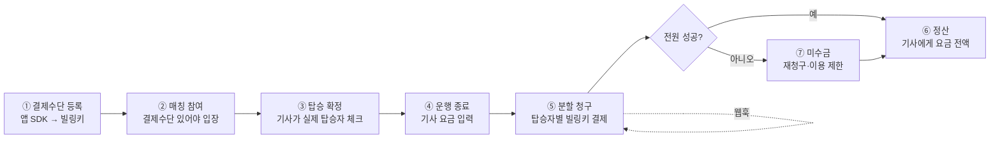
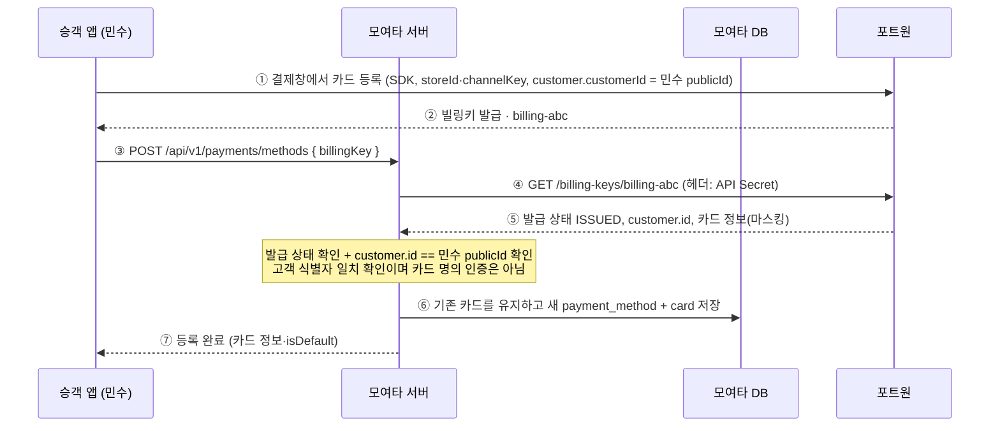
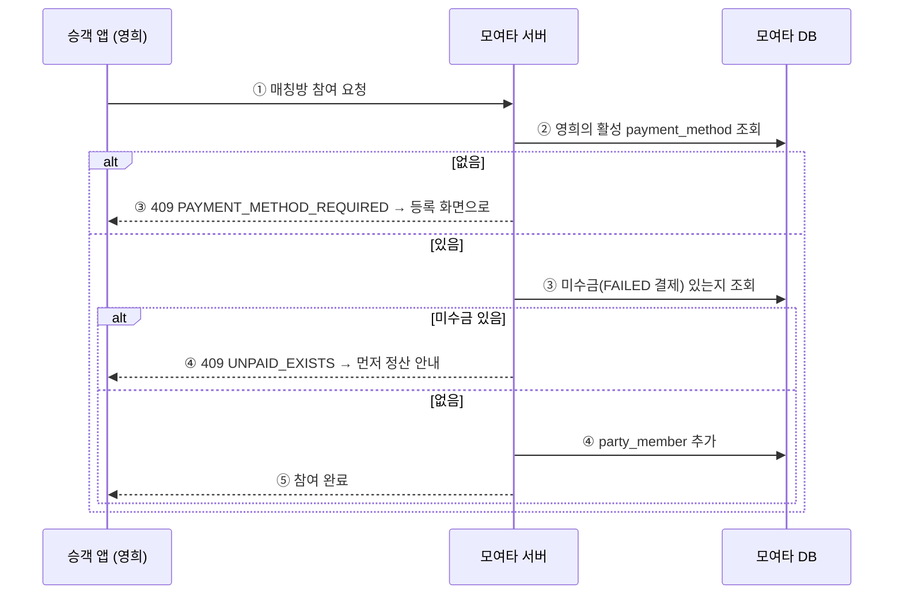
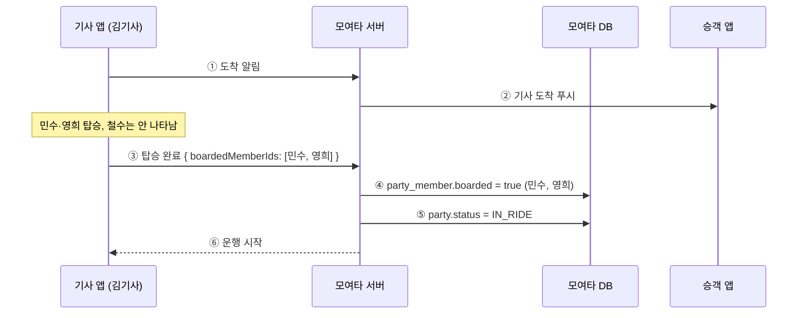
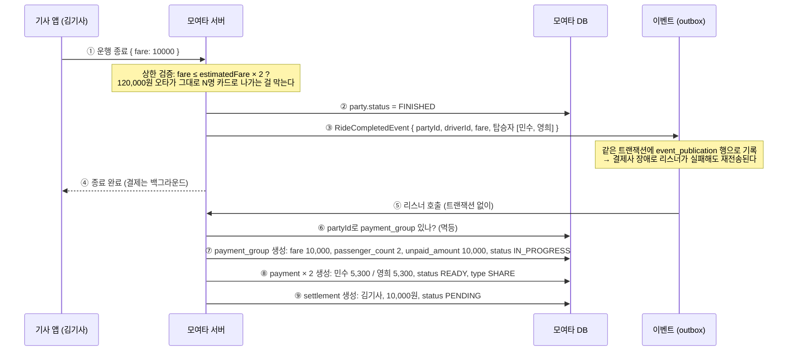
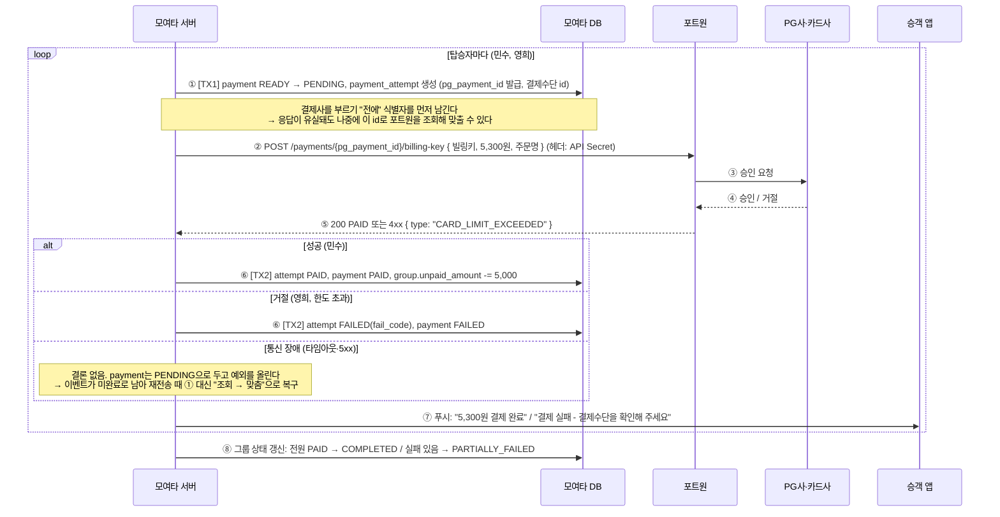
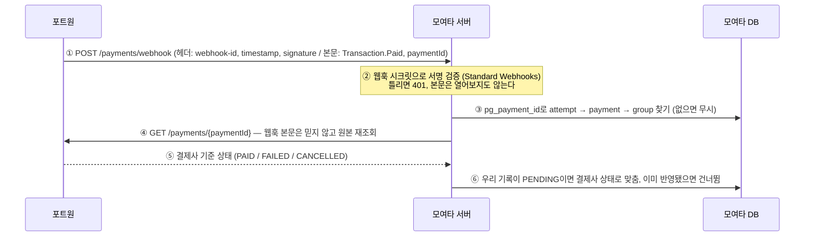
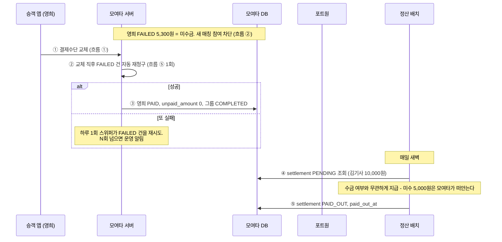
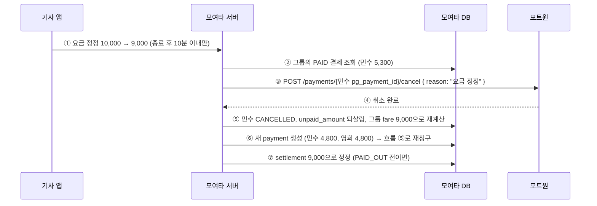

# 모여타 결제 흐름 — 택시 동승 분할 결제

포트원 V2 빌링키를 바탕으로, 모여타 안에서 결제가 **언제·누구 사이에서·어떤 순서로** 일어나는지 정리한 문서다.
"프로젝트에 결제 적용 ①"에서 정리한 값(storeId, channelKey, API Secret, 웹훅 시크릿, 빌링키)이 각 단계 어디에서 쓰이는지도 같이 표시한다.

## 0. 전제

### 모델: 사후 청구 + 플랫폼 보증

| 질문          | 모여타의 답                                                    |
| ----------- | --------------------------------------------------------- |
| 언제 결제하나     | 운행이 끝나고 기사가 요금을 입력한 직후, 서버가 자동으로                          |
| 누가 결제를 시작하나 | 승객이 아니라 **서버**. 앱에는 "결제하기" 버튼이 없다                         |
| 얼마씩 내나      | 요금을 **실제 탑승자 수로 균등 분할** + 1인당 플랫폼 이용료                     |
| 한 명이 실패하면   | 기사에게는 모여타가 전액 지급(보증), 실패한 승객은 **미수금**으로 남겨 재청구·이용 제한으로 회수 |
| 선결제는        | 2단계. 미수율이 문제가 되면 "탑승 시 예상요금 선결제 → 종료 후 차액 정산"으로 전환        |

### 등장인물

| 이름      | 역할                                                                      |
| ------- | ----------------------------------------------------------------------- |
| 승객 앱    | 결제수단 등록, 매칭 참여, 결제 결과 확인·재시도                                            |
| 기사 앱    | 탑승자 확정, 운행 종료 시 요금 입력                                                   |
| 모여타 서버  | 분할 계산, 빌링키 결제 요청, 결과 기록, 정산                                             |
| 모여타 DB  | payment_method / payment_group / payment / payment_attempt / settlement |
| 포트원     | 빌링키 발급·보관, 결제 중계, 웹훅 발송                                                 |
| PG사·카드사 | 실제 승인·거절                                                                |

### 예시로 쓰는 운행

- 방: 강남역 → 판교역, 정원 3명 (민수·영희·철수)
- 기사: 김기사
- 기사가 입력한 요금: **10,000원**, 플랫폼 이용료: **300원/인**
- 분담금: 민수 3,334 / 영희 3,333 / 철수 3,333 (합 10,000) + 각 300원 → 청구액 3,634 / 3,633 / 3,633

## 전체 그림



결제가 "일어나는" 곳은 ⑤ 하나뿐이다. 나머지는 ⑤가 실패 없이 돌게 하기 위한 준비(①~④)와 뒷정리(⑥~⑦)다.

## 흐름 ① 결제수단 등록 — 카드 한 번 등록, 이후엔 빌링키

블로그 ①의 "카드 등록과 빌링키 저장 흐름"에 **서버 검증**이 추가된 버전이다. 앱이 보낸 빌링키를 그대로 믿지 않는다.



- **여러 카드를 보관하고 기본 카드는 하나만 선택한다.** 첫 카드는 자동으로 기본 지정하며 이후 등록은 기본 선택을 유지한다.
- `GET /api/v1/payments/methods`: 본인의 등록 카드 목록. 각 응답에 `isDefault`를 포함한다.
- `PUT /api/v1/payments/methods/{methodId}/default`: 본인의 사용 가능한 카드 중 기본 카드를 선택한다. 본문은 없으며 기존 카드와 빌링키는 삭제하지 않는다.
- V19 마이그레이션은 기존 활성 카드를 기본으로 승계한다. 과거 비활성 카드와 삭제된 빌링키는 복원하지 않는다.
- **빌링키는 로그에 남기지 않는다.** 카드번호는 포트원이 주는 마스킹값만 저장.
- 쓰이는 값: storeId·channelKey(앱 SDK), API Secret(④), 빌링키(⑤~⑦).

## 흐름 ② 매칭 참여 — 결제수단이 없으면 못 탄다

지금 코드는 운행이 끝난 뒤에야 "결제수단 없음"으로 실패한다. 그 시점엔 이미 태워줬으므로 너무 늦다. 검사를 **입장 시점**으로 당긴다.



- 진행 중인 방(모집 완료 이후)이 있으면 **결제수단 삭제를 막는다.** 탑승 직전에 카드를 지워 버리는 경우를 차단.

## 흐름 ③ 탑승 확정 — 실제로 탄 사람만 나눈다

방 구성원 ≠ 탑승자다. 노쇼가 있으면 탄 사람들끼리만 나눠야 하고, 안 탄 사람 카드가 긁히면 안 된다.



- 이 시점의 `boarded` 명단이 분할 대상이다. 예시는 이제 **2명**이 되어 5,000 / 5,000 + 300원씩이 된다.
- (선결제 모델이면 바로 이 ③~④ 사이에서 예상요금 선결제가 들어간다.)

## 흐름 ④ 운행 종료 — 요금 입력과 결제 그룹 생성



- **기사 요금 입력은 결제가 아니라 "확정 신호"다.** 실제 청구는 이벤트를 받은 결제 모듈이 한다.
- ⑥의 멱등 검사 덕분에 이벤트가 두 번 와도 그룹은 하나다. (`payment_group.party_id` unique)
- ⑨ settlement는 **수금 여부와 무관하게** 이 시점에 전액으로 만든다. 플랫폼 보증의 핵심.

## 흐름 ⑤ 분할 청구 — 블로그 ②의 흐름이 탑승자 수만큼 반복된다



- 청구 1건 = **DB 트랜잭션 2개 + 그 사이 HTTP 1번.** 결제사 응답을 기다리는 동안 DB 잠금을 쥐고 있지 않기 위해서다.
- `pg_payment_id`는 **시도마다 새로 발급**한다. 재시도하면 새 attempt 행이 생기고 이전 시도는 그대로 남는다.
- 결제 실패(④ 거절)와 통신 장애(⑤ 없음)는 **다른 상태**다. 전자는 FAILED로 확정, 후자는 PENDING 유지.
- 예시 결과: 민수 PAID, 영희 FAILED → unpaid_amount 5,000, 그룹 PARTIALLY_FAILED.

## 흐름 ⑥ 웹훅 — 응답과 별개로 오는 두 번째 통지



- 웹훅이 ⑤의 응답보다 **먼저** 올 수도 있다. 그래서 ⑥은 "PENDING일 때만 반영"이다.
- 쓰이는 값: 웹훅 시크릿(②), API Secret(④).

## 흐름 ⑦ 실패 이후 — 미수금, 재청구, 그리고 기사 정산



- 기사는 **승객이 냈든 안 냈든** 요금 전액을 받는다. 미수 회수는 모여타와 승객 사이의 일이다.
- 지금 코드의 "동승자 대납(COVER)"은 이 모델에서 빠진다. 모르는 사람 요금을 대신 낼 동기가 없다.
- 미수가 쌓이는 패턴(같은 유저 반복)은 이용 제한으로 막는다. 결제 로직이 아니라 정책이다.

## 흐름 ⑧ 취소·정정 — 모여타가 먼저 취소를 보내는 경우



- MVP는 **전액 취소 → 재청구**로 단순하게. 부분 취소(차액만)는 선결제 모델로 갈 때 같이 도입.
- 취소도 웹훅(Transaction.Cancelled)이 오므로 흐름 ⑥이 똑같이 동작한다.

## 상태 한눈에

### payment (승객 1명의 결제 1건)

```
READY ──청구 시작──▶ PENDING ──승인──▶ PAID ──취소──▶ CANCELLED
                       │
                       └──거절──▶ FAILED ──재청구──▶ PENDING (새 attempt)
```

| 상태 | 뜻 | 누가 바꾸나 |
|---|---|---|
| READY | 만들어졌고 아직 결제사에 안 보냄 | 그룹 생성 |
| PENDING | 결제사에 보냈고 결론 대기 | 청구 직전 |
| PAID | 승인 | API 응답 또는 웹훅 |
| FAILED | 거절 (fail_code 있음) | API 응답 또는 웹훅 |
| CANCELLED | 승인 후 취소 | 정정·환불 또는 웹훅 |

### payment_group (운행 1건)

| 상태               | 뜻                                        |
| ---------------- | ---------------------------------------- |
| IN_PROGRESS      | PENDING인 결제가 남아 있음                       |
| PARTIALLY_FAILED | 전부 결론 났지만 FAILED가 있음 (unpaid_amount > 0) |
| COMPLETED        | unpaid_amount == 0                       |
| CANCELLED        | 운행 자체가 무효 처리돼 전부 취소                      |

## 환경 변수가 쓰이는 자리

| 값                   | 쓰이는 흐름                               |
| ------------------- | ------------------------------------ |
| storeId, channelKey | ① 앱 SDK 빌링키 발급                       |
| V2 API Secret       | ① 빌링키 조회·삭제, ⑤ 빌링키 결제, ⑥ 결제 조회, ⑧ 취소 |
| 웹훅 시크릿              | ⑥ 서명 검증                              |
| 빌링키                 | ① 저장, ⑤ 결제 요청 본문                     |
|                     |                                      |

## 선결제 모델로 바꾸면 달라지는 곳

지금 문서는 사후 청구 기준이다. 미수율이 문제가 되어 선결제로 옮길 때 바뀌는 지점만 적어 둔다.

- 흐름 ③ 탑승 확정 직후 `estimatedFare` 기준으로 흐름 ⑤를 한 번 돈다. 실패한 사람은 안 태운다.
- 흐름 ④ 운행 종료 때 확정 요금과 비교해 **차액만** 추가 청구하거나 **부분 취소**한다. `payment.type`에 PREPAY / ADJUST가 생기고 부분 취소 테이블이 필요하다.
- 흐름 ⑦의 미수금은 거의 사라진다. 플랫폼 보증은 차액 추가 청구가 실패한 소액에만 남는다.

## 로컬에서 돌려보기 (가짜 결제사)

빌링키는 앱 SDK만 발급할 수 있어서 백엔드 단독으로는 포트원을 끝까지 못 탄다. `fakepay` 프로파일을 켜면 포트원 대신 메모리 가짜 결제사가 붙어 위 흐름을 전부 걸을 수 있다.

```bash
docker run -d --rm --name moyeota-redis -p 6379:6379 redis:7-alpine
```

```bash
./gradlew bootRun --args='--spring.profiles.active=h2,fakepay'
```

- 빌링키 문자열로 시나리오를 고른다. `fake-{publicId}`는 승인, `-decline`은 거절, `-outage`는 요청 유실, `-lost`는 승인 후 응답 유실.
- 매칭·배차 없이 운행 종료를 넣는 API, 결제사 장애 on/off, 웹훅 수신 흉내, 결제사 쪽 취소가 `/api/v1/payments/fake/**` 아래에 있다. 운영에는 뜨지 않는다.
- 걷는 순서는 [http/payment-fake.http](../http/payment-fake.http)에 흐름 번호대로 적어 두었다.

