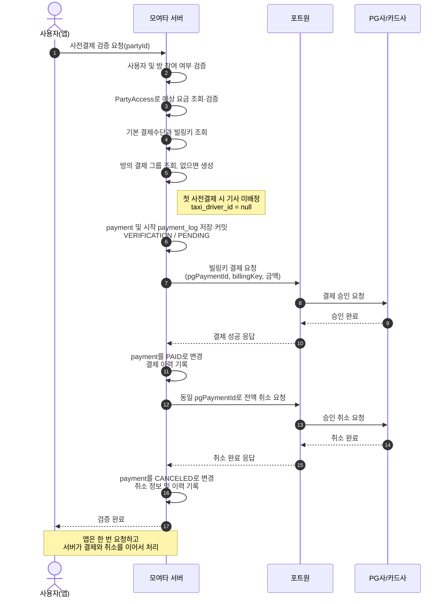
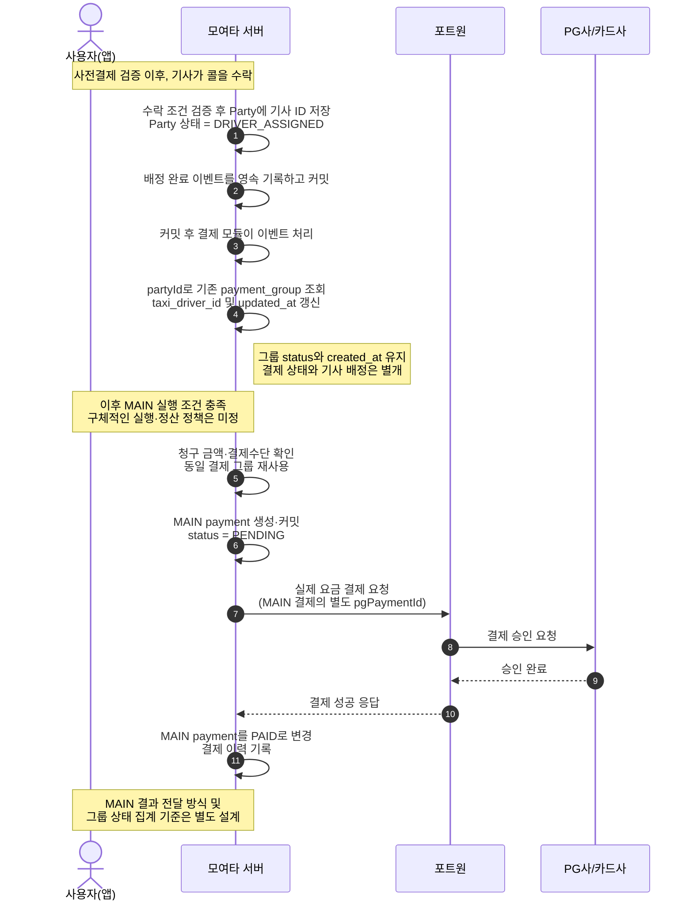
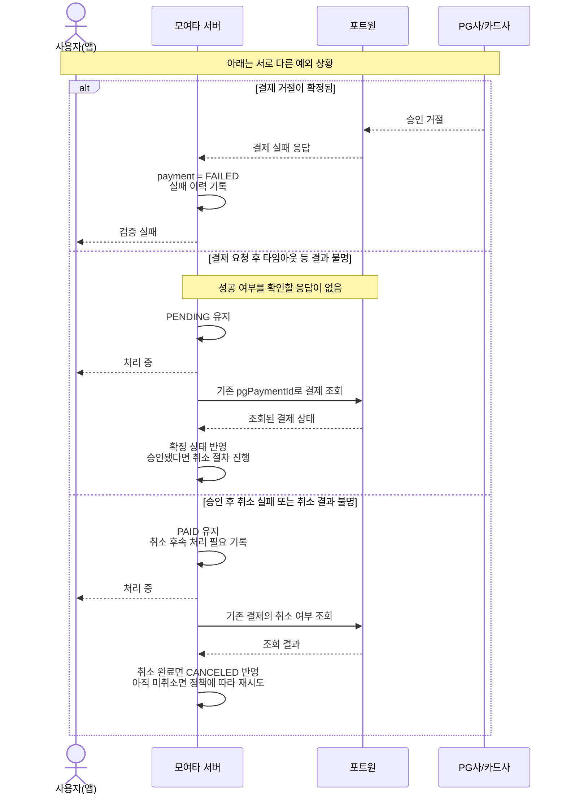

# 사전결제·취소를 통한 결제 가능 여부 검증 — 설계 및 구현 순서

## 개발 기록 관리

- 개발 계획과 진행 상태는 이 문서를 계속 기준으로 삼는다.
- [2026-10-27 개발 기록](2026-10-27-payment-verification-dev-log.md)은 27일까지의 논의·변경·검증 이력으로 보존한다.
- 2026-10-28부터의 논의·변경·검증은 [2026-10-28 개발 기록](2026-10-28-payment-verification-dev-log.md)에 이어서 기록한다.
- 설계와 진행 상태가 바뀌면 이 계획을 갱신하고, 변경 이유와 검증 근거는 해당 날짜의 개발 기록에 남긴다.
- 사용자가 IntelliJ에서 직접 작성하는 코드도 후속 대화·작업 시 저장된 파일과 Git 변경 사항을 확인해 개발 기록에 남긴다. 확인 시점의 사실과 사용자가 설명한 의도를 구분하며, 저장되지 않은 편집이나 상시 감시를 전제로 하지 않는다.

## 구현하려는 기능

사용자가 등록한 **기본 결제수단으로 서버가 정한 금액을 결제한 뒤, 같은 결제 건을 전액 취소**한다. 이를 통해 현재 해당 금액을 결제할 수 있는지 확인한다.

클라이언트는 검증 API를 한 번 호출한다. 백엔드가 사전결제부터 취소, 결과 저장, 미완료 작업의 후속 처리까지 책임진다. 사전결제와 취소는 하나의 `PaymentService` 안에서 각각 `prePay()`와 `cancelPrepayment()` 메서드로 구분하고, 하나의 컨트롤러 API에서 순서대로 연결한다.

현재 범위에서는 포트원 웹훅을 사용하지 않는다. 정상 처리에서는 결제·취소 API의 응답을 서비스가 해석해 결과를 저장한다. `PaymentController`는 결제 → 취소 → 응답만 연결한다. 각 서비스 메서드는 성공 확인 후에만 정상 반환하며, 실패·미확정은 구분된 업무 예외로 전달한다. HTTP 오류 응답은 공통 예외 처리기가 담당한다. 응답 유실·타임아웃은 실패로 단정하지 않고 기존 `pgPaymentId`로 조회·복구한다.

**현재 구현 범위(2026-10-28 저장된 코드 기준):** `PaymentController`는 `prePay()`의 내부 결제 ID를 `cancelPrepayment()`에 전달하도록 연결되어 있다. `prePay()`에는 사용자 존재·방 존재·참여·예상 요금 검증, 기본 결제수단·빌링키 조회, 기존 결제 그룹 재사용 및 없을 때 생성까지 작성되어 있다. 이후 결제 기록 저장·외부 결제 호출·결과 저장과 취소 처리는 미구현이며, 두 메서드는 `UnsupportedOperationException`을 던진다. 현재 `prePay()` 트랜잭션에서는 신규 그룹 저장도 마지막 예외로 롤백된다. 다섯 엔티티·기본 CRUD 저장소 작성과 실제 결제·취소 기능 완료는 구분한다.

**검증 근거:** 기존 28일 개발 기록에는 `PaymentPreparationTest`의 6개 사례와 메인·테스트 컴파일 통과가 남아 있다. 이는 모의 저장소를 사용한 준비 단계 검증이며 실제 DB 커밋·동시성·결제 연동 검증은 아니다. 이번 문서 동기화에서는 소스만 재확인했으며 테스트를 다시 실행하지 않았다.

```text
사용자의 검증 요청
  → 사용자·방 참여 권한 확인
  → 매칭 모듈에서 예상 요금 조회 및 검증
  → 기본 결제수단·빌링키 조회 및 검증
  → 방의 결제 그룹 조회, 없으면 생성
  → 결제 요청 기록 저장·커밋
  → 사전결제 실행 및 결과 저장
  → 성공한 결제 건 전액 취소 및 결과 저장
  → 최종 검증 결과 응답
```

이 기능은 잔액을 직접 조회하는 기능이 아니다. 현재 해당 금액의 결제 가능 여부를 확인하며, 취소 이후 실제 운행 요금을 청구할 때도 결제가 가능하다는 것을 보장하지 않는다. 예상 요금을 보관했다가 운행 종료 후 차액을 정산하는 선결제 방식과도 구분한다.

## 2026-10-28 커밋 및 검증 현황

- `c9d46bf`: 결제수단 유형 enum 패키지 이동. 해당 커밋 소스에서 기존 결제수단 테스트 통과.
- `1a1658f`: 다섯 결제 엔티티·enum·저장소 추가. 해당 커밋 소스의 compileJava 통과. 마이그레이션은 미포함.
- `c8e26a8`: 사전결제 준비 단계와 API 골격 추가. 포트원 초안을 제외한 해당 커밋 소스에서 PaymentPreparationTest 6개 통과.
- 포트원 신규 결제 호출·DTO 초안은 명세·동작 검증 전이므로 미커밋으로 유지했다. 서비스의 실제 결제·취소와 시작 이력 저장은 여전히 미완료다.
- 커밋별 파일·코드 범위와 분리 이유는 [28일 개발 기록](2026-10-28-payment-verification-dev-log.md)의 커밋 분리 기록에 남긴다. 기존 시점별 검증 기록과 구분한다.

## 시퀀스 다이어그램으로 보는 전체 흐름

현재까지 정리한 **목표 설계**다. 모든 단계가 구현된 것은 아니다. 네 주체만 표시하므로 DB 저장과 모듈 간 이벤트 처리는 모여타 서버의 내부 작업으로 표현한다. 이력 기록 시점과 MAIN 세부 정책처럼 미정인 부분은 아래에 구분한다.

### ① 사전결제 → 전액 취소: 정상 흐름



`CANCELED`는 결제 건이 취소되었다는 뜻이며, 이 정상 흐름에서는 검증 절차가 완료된 것이다. `payment_log`에 PENDING 시작 이력을 남기는 것은 확정했다. 그림의 결제 행·시작 로그 동시 커밋과 승인·취소 확정 시 결과 로그 추가는 구현 제안이며, 정확한 기록 지점과 중복·재시도 정책은 별도 확정한다. `payment_cancel`의 최초 생성 시점 역시 미정이다.

### ② 이후 기사 배정 → MAIN 결제

사전결제 요청이 끝난 뒤 발생하는 별도 흐름이다. 기사 앱을 주체로 추가하지 않고, 콜 수락 처리는 서버 내부 설명으로 표시했다. MAIN은 같은 그룹을 재사용한다는 관계를 중심으로 표현하며 실행 시점·금액 계산·정산 저장 시점은 아직 상세 설계 대상이다.



정상적으로 두 유형의 결제가 모두 생성되면 사용자 n명에 대해 `VERIFICATION` n행과 `MAIN` n행이 같은 그룹에 연결된다. MAIN은 검증 결제처럼 성공 직후 자동 취소하지 않는다. 재시도 모델과 `payment_settlement`의 계산·저장 시점은 이 그림에서 확정하지 않는다.

### ③ 정상 흐름에서 벗어났을 때



조회 결과도 미확정이면 성공·실패로 단정하지 않고 후속 확인 대상으로 유지한다. 취소 재처리 정보의 저장 위치와 반복 실패 시 대응은 추가 설계한다. 서버 중단이나 앱 연결 종료 후에도 저장된 기록으로 후속 처리를 이어가는 것이 목표다.

## 진행 방식

- 이 문서는 최초 계획을 고정한 문서가 아니라, 대화에서 확정한 최신 설계를 반영하는 작업 계획이다.
- 설계·범위·순서·완료 기준이 바뀌면 해당 내용을 갱신하고, 변경 이유와 이전 판단은 [현재 개발 기록](2026-10-28-payment-verification-dev-log.md)에 남긴다.
- 대화 중 제안과 확정된 변경을 구분한다. 사용자의 생각이나 질문을 곧바로 확정된 요구사항으로 기록하지 않는다.
- 완료한 작업도 설계 변경으로 수정이 필요해지면 재작업 필요 상태를 표시하고 후속 작업을 추가한다. 과거 완료 및 검증 사실은 개발 기록에 보존한다.
- 기존 작업 번호는 추적 식별자로 유지한다. 작업이 분리되면 `14-1`처럼 하위 번호를 부여하고, 순서 변경·대체·제외 관계를 명시해 개발 기록과의 연결을 유지한다.
- 아래 체크 항목 하나를 하나의 작업 단위로 진행한다.
- 각 작업에서 변경 이유, 변경한 코드, 요청 한 건이 지나가는 흐름, 확인 결과를 설명한다.
- 코드를 이해하고 해당 작업의 완료 기준을 확인한 뒤 다음 단계로 넘어간다.
- 미정인 정책을 임의로 코드에 고정하지 않는다. 설계 단계에서 먼저 결정한다.
- 상태 변경, 금액 계산, 외부 통신 등 동작을 추가할 때마다 해당 동작을 검증한다. 테스트를 마지막에 몰아서 진행하지 않는다.
- 명시적으로 확정된 항목 외의 클래스명, API 경로, 상태 모델은 설계 제안이다.

## 초기 코드의 출발점과 현재 변경

아래 목록은 최초 검토 시점의 출발점이다. 이후 `PaymentController`와 서비스 골격을 추가하고, 기존 검증·조회 로직을 `PaymentService`로 이동했다. 중복 컨트롤러 매핑과 DTO 컴파일 오류를 정리했으며, 당시 컴파일과 관련 테스트는 통과했으나, 현재 상태는 문서 상단과 최신 개발 기록을 기준으로 한다. 실제 결제 호출·저장·취소 연동은 아직 미완료다.

- `PaymentMethodService.prePay()`에는 사용자 존재, 방 참여 여부, 예상 요금, 기본 결제수단과 빌링키 조회가 작성되어 있다.
- 실제 결제 호출, 결제 기록 저장, 취소 처리는 아직 연결되지 않았다.
- `PortOneClient.payWithBillingKey()`는 작성 중이며, 취소 메서드는 미완성이다.
- `Payment`, `PaymentGroup`, 관련 상태 enum이 있으나 검증 결제 저장·상태 변경 흐름은 미완성이다.
- 컨트롤러에 중복 메서드와 동일한 POST 경로가 있고, DTO 문법과 미완성 선언 등 컴파일을 막는 코드가 있다.
- 기존 [payment-flow.md](payment-flow.md)는 사후 청구와 향후 선결제 정산을 중심으로 설명한다. 이번 검증 기능의 구현 현황을 의미하지 않는다.

## 1단계 — 코드 없이 정책 결정

### 설계 기준으로 제공된 ERD

2026-10-28 사용자가 `payment_settlement`를 포함한 다섯 테이블의 최신 명세를 제공하고 엔티티·레포지터리 작성을 요청했다. 최신 필드 기준과 실제 구현 내역은 [28일 개발 기록](2026-10-28-payment-verification-dev-log.md)에 남긴다. 아래 네 테이블 설명은 기존 논의의 배경이며, 요금·수수료 정보는 이제 `payment_settlement`에 둔다.

- [x] 다섯 엔티티의 필드·PK·문자열 enum 매핑과 기본 생성 메서드를 작성했다.
- [x] 다섯 `JpaRepository<엔티티, Long>`를 작성했다. 취소·정산은 기존 결제·그룹 ID를 PK로 사용한다.
- [ ] 실제 DB 마이그레이션, 제약 설계, 저장·조회 통합 검증은 별도 진행한다.

사용자가 이번 결제 API에서 다룰 테이블로 `payment`, `payment_group`, `payment_log`, `payment_cancel`을 제시했다. 원문 컬럼과 상태는 [2026-10-27 개발 기록](2026-10-27-payment-verification-dev-log.md)의 ERD 제공 기록에 보존한다.

- `payment`: 결제 한 건의 현재 정보와 상태를 관리하는 기준 테이블.
- `payment_group`: 방 하나당 그룹 하나를 두며 첫 사전결제 시작 시 생성한다. 같은 방의 VERIFICATION과 MAIN 결제는 이 그룹을 공유한다. 그룹 상태 집계 기준은 추가 설계가 필요하다.
- 사전결제는 방 생성 후 기사 매칭 전에 실행한다. `payment_group.taxi_driver_id`는 초기 null을 허용하고 기사 배정 확정 후 갱신한다. 결제 상태 변화만으로 기사 배정을 추정하지 않는다.
- `payment_log`: 결제 이력. 상태 변경 이력인지 결제 시도 이력인지, 어떤 시점에 추가할지 먼저 정의한다.
- `payment_cancel`: 취소 정보. 제공된 PK가 `payment_id`이므로 결제당 최대 한 행이며, 여러 취소 시도를 각각 저장하는 구조는 아니다.

ERD 원문과 달리 `payment.status`는 `PENDING`, `PAID`, `FAILED`, `CANCELED` 네 가지로 확정했다. `payment.type`은 `VERIFICATION`, `MAIN` 두 가지이며 상태에 유형 접두사를 붙이지 않는다. `READY`는 생략한다. 그룹 상태의 `CANCELLED` 표기는 이번 변경 대상이 아니다. FK, null 허용, 기본값, 길이, 인덱스는 제공된 정보만으로 확정하지 않는다.

### 01. 예상 요금 조회와 사용 기준 정리

- [x] `estimatedFare`는 매칭 모듈의 `Party`에 저장된 값을 읽어오는 것으로 확인했다. 결제 모듈에서 예상 요금을 생성하거나 계산하지 않는다.
- [x] 현재 조회 경로는 `PartyAccess.findSummary(partyId)` → `PartySummary.estimatedFare()`다. 매칭 엔티티를 결제 모듈에서 직접 조회하는 구조로 바꾸지 않는다.
- [ ] 조회한 값을 그대로 검증 결제 금액으로 사용할지 최종 확인한다. 별도 분담금 계산 요구는 아직 확정되지 않았으므로 구현 범위로 가정하지 않는다.
- [ ] 금액이 없거나 0 이하인 경우의 처리 기준을 정한다.

**완료 기준:** 예상 요금의 소유 모듈과 조회 경로, 조회값의 사용 방식 및 유효성 검사 기준을 설명할 수 있다.

**첫 작업 요청 예시:**

> 매칭 모듈의 Party에 저장된 estimatedFare를 현재 결제 코드가 어떻게 읽는지 설명해줘. 값이 없거나 0 이하인 경우의 처리도 정리해줘. 코드는 수정하지 마.

### 02. 실행 시점 결정

- [ ] 방 참여 이후 어느 시점에 검증할지 결정한다.
- [ ] 검증을 허용하는 방 상태와 검증 실패 시 이후 행동을 정한다.

현재 코드는 방 참여 여부를 먼저 검사하므로, 그대로 사용하면 방 참여 이후 실행하는 흐름이다.

**완료 기준:** 누가 어떤 상황에서 검증 API를 호출하는지 설명할 수 있다.

### 03. 성공·실패·처리 중 기준 결정

- [ ] 결제와 전액 취소가 모두 완료되었을 때 검증 완료로 처리한다.
- [ ] 결제 거절이 확정된 경우와 결과를 아직 모르는 경우를 구분한다.
- [ ] 결제 성공 후 취소 실패·지연 시 클라이언트 응답을 정한다.

**완료 기준:** 정상 완료, 결제 거절, 결제 결과 불명, 취소 미완료 각각의 응답 의미가 정해진다.

### 04. 중복 요청·재검증 기준 결정

- [ ] 같은 사용자·방에서 어떤 요청을 동일한 검증 작업으로 볼지 정한다.
- [ ] 처리 중 재요청은 기존 작업을 어떻게 이어갈지 정한다.
- [ ] 완료 이후 언제 새로운 검증을 허용할지 정한다.

**완료 기준:** 같은 요청의 재전송과 의도적인 새 검증을 구분할 수 있다. 사용자·방 조합을 영구적으로 하나의 검증으로 제한하지 않도록 재검증 정책도 함께 고려한다.

## 2단계 — 기존 코드와 책임 정리

### 05. 컴파일을 막는 코드 정리

- [ ] 중복 메서드, record 문법, 미완성 선언, 선언되지 않은 변수 참조를 정리한다.
- [ ] 실제 결제 동작 추가와 섞지 않고 컴파일 가능한 상태를 만든다.
- [ ] 미완성 기능이 성공한 것처럼 응답하지 않도록 한다.

**완료 기준:** 컴파일 결과를 확인하고, 아직 미구현인 부분을 설명할 수 있다.

### 06. 컨트롤러 경로 정리

- [ ] 결제수단 관리 API와 검증 API 경로를 구분한다.
- [ ] 동일한 POST 매핑 충돌과 경로 변수 누락을 해결한다.
- [ ] 인증 정보에서 사용자 ID를 받고, 서버에서 금액과 결제수단을 결정하도록 입력을 설계한다.

확정 경로: `POST /api/v1/payments/parties/{partyId}/verifications`

확정 컨트롤러 메서드명: `verifyPaymentCapability`. 사용자 ID는 인증 정보에서, 방 ID는 경로에서 받는다. 복수형 명사는 리소스 컬렉션을 표현하는 관례이며 REST의 필수 문법은 아니다.

**완료 기준:** 각 API의 경로와 입력이 명확하고 서로 충돌하지 않는다.

### 07. 서비스 책임과 메서드 입출력 설계

- [x] `PaymentMethodService`에는 카드 등록·조회·기본 카드 선택·삭제 책임을 둔다.
- [x] `PaymentService.prePay(userId, partyId)`는 성공 확인 후 `PaymentResultResponse`를 반환하는 계약으로 정했다. 현재 외부 결제 구현은 미완료다.
- [ ] `PaymentService.cancelPrepayment()`는 컨트롤러의 호출 계약만 남아 있으며 사용자가 직접 작성한다.
- [x] 컨트롤러가 `PaymentService.prePay()`를 호출하고 반환 결과의 결제 ID를 같은 서비스의 `cancelPrepayment()`에 전달하는 구조로 정했다. 별도 전체 흐름 조정 서비스 도입은 현재 필수로 두지 않는다.
- [x] 서비스가 성공 확인 후에만 반환하고 실패·미확정 시 예외를 던지는 방식으로 정했다. 컨트롤러에는 `isPaid()` 분기나 `try-catch`를 두지 않는다. 실패 기록이 롤백되지 않도록 결과 저장 트랜잭션은 이후 구현에서 분리한다.
- [ ] 취소 서비스는 전달받은 ID로 저장된 결제의 소유자·유형·상태를 검증하고, 저장된 pgPaymentId로 취소한다. 클라이언트 응답 DTO 전체를 서비스 간 계약으로 사용할 필요는 없다.

```text
사용자 ID + 방 ID
  → PaymentService.prePay()
  → 내부 결제 ID와 결제 처리 결과
  → PaymentService.cancelPrepayment()
  → 최종 검증 결과
```

**완료 기준:** 각 클래스의 책임과 서비스 사이에 전달하는 값을 설명할 수 있다. 복구나 다른 업무에서도 전체 흐름을 재사용하게 되면 별도의 조정 서비스를 둘 수 있다.

## 3단계 — 결제 기록 설계 및 저장

### 08. Payment 필드 설계

- [x] 방 하나의 사전결제와 MAIN 결제를 하나의 `payment_group_id`에 연결한다.
- [x] 첫 사전결제 시작 시 그룹을 만들고 이후 결제는 기존 그룹을 재사용한다.
- [x] 사용자 n명에 대해 VERIFICATION과 MAIN을 각각 한 건 생성하므로, 두 유형이 모두 생성된 시점의 기본 구조는 `payment` 2n행이다. 최초 요청에서 2n행을 미리 생성한다는 뜻은 아니다.
- [x] 데이터 생성 순서는 `payment_group` → `payment` → `payment_log`다. 테이블 자체를 요청마다 생성하지 않고, 기존 테이블에 행을 저장한다.
- [x] 2026-10-28 제공된 다섯 테이블 기준으로 엔티티를 맞췄다. `Payment`의 취소 필드는 `PaymentCancel`로 분리하고, 그룹의 요금·수수료 필드는 `PaymentSettlement`로 이동했다. 그룹 기사 필드는 `taxiDriverId`로 변경했다.
- [x] 첫 그룹 생성 시 기사는 미배정이다. `taxi_driver_id`는 초기 null을 허용하고 이후 배정 확정 시 채운다.
- [x] 기사 콜 수락 성공은 배정 완료 이벤트로 결제 모듈에 전달하고, 수락 트랜잭션 커밋 이후 결제 그룹에 반영하는 방향으로 정했다. 구현은 12-1~12-5에서 진행한다.
- [ ] 기사 배정 취소·재배정 시 갱신 규칙과 최종 운행 기사 ID를 확정할 시점을 설계한다.
- [ ] 첫 그룹 생성 시 탑승 인원 정보의 확정 여부와 미확정 필드 처리 방식을 확인한다.
- [ ] 방당 그룹 하나를 동시 요청에서도 보장하는 제약·충돌 처리와, 기존 그룹 ID를 각 결제에 연결하는 구현을 설계한다.
- [ ] 실패 후 재시도 시 기존 결제 행을 사용할지, 시도 이력을 어떻게 남길지 정한다. 2n 구조를 기준으로 검토하되 재시도 상세 정책을 임의로 확정하지 않는다.
- [ ] `payment_log` 기록 단위와 `payment_cancel` 생성 시점을 각각 작은 후속 작업으로 설계한다.
- [x] 2026-10-28 사용자 결정: `payment_log`에도 `PENDING`을 포함해 결제 시작 이력을 남긴다. 시작부터 결과까지 이력만으로 조회하고, 시작 후 결과가 기록되지 않은 건을 추적하며, 서버가 관측한 처리 시간을 확인하기 위한 선택이다. `payment.createdAt`과 일부 중복되지만 조회·추적의 편의를 우선한다.
- `payment`는 현재 상태, `payment_log`는 과거 상태 이력을 담당한다. 상태 용어를 맞춘다는 이유로 과거 로그를 현재 상태로 덮어쓰지 않는다. 상태별 행 추가 방식은 제안이며 재시도·중복 기록 정책은 후속 설계한다.
- `PENDING` 시각은 서버의 처리 시작 기록으로, 포트원 요청 송신·수신 시각을 보장하지 않는다. 결과 기록까지의 차이는 저장·통신·결과 반영 지연을 포함할 수 있다. 결과 이력이 없는 건도 실패로 단정하지 않는다. 상세 판단은 [28일 개발 기록](2026-10-28-payment-verification-dev-log.md)에 남긴다.
- `PaymentLogStatus`의 PENDING 선언과 주석을 결정에 맞췄다. `PaymentLog.create()`는 PENDING을 전달받을 수 있다. 서비스의 후속 작업 주석에도 시작 로그 저장·외부 호출 전 커밋을 명시했다. 실제 이력 저장 로직과 트랜잭션 분리는 아직 구현하지 않았다.
- [ ] 내부 결제 ID, `pgPaymentId`, 사용자, 방, 사용한 결제수단, 금액, 통화, 결제 유형을 정한다.
- [ ] 결제·취소 상태, 실패 사유, 처리 시각, 재처리에 필요한 정보를 정한다.
- [x] 검증 결제도 `PaymentGroup`을 사용한다. 별도 `partyId` 컬럼의 필요성은 그룹을 통한 방 연결과 비교해 결정한다.
- [ ] 내부 `paymentId`, 포트원 요청 식별자 `pgPaymentId`, 응답의 `pgTxId`를 구분한다.

**완료 기준:** 각 필드를 왜 저장하는지 설명할 수 있고, 검증 결제를 방과 연결하는 방식이 정해진다.

### 09. 결제·취소 상태 설계

- [x] `PaymentStatus`는 `PENDING`, `PAID`, `FAILED`, `CANCELED`로 확정하고 코드에 반영했다.
- [x] `PaymentType`은 `VERIFICATION`, `MAIN`을 사용한다. 두 유형이 공통 결제 상태를 사용한다.
- [x] 검증 결제의 정상적인 전액 취소도 결제 상태는 `CANCELED`다. 검증 절차의 완료 여부와 결제 상태를 구분하고 취소 사유로 목적을 기록한다.
- 취소 진행·실패·재시도 정보의 저장 위치는 별도 미결정 사항이다. 이번 네 가지 결제 상태 확정만으로 해당 설계가 완료된 것은 아니다.
- [x] 현재의 즉시 결제 흐름에서는 `READY`를 생략하고 `PENDING`으로 결제 기록을 생성한다. 사용자·방·금액·기본 결제수단 검증과 조회를 먼저 마친다.
- [x] 결제 기록 저장은 기존 `payment` 테이블에 행을 추가하고 커밋하는 것이다. 요청마다 테이블을 생성하는 것이 아니다.
- [x] `PENDING`은 결제 처리를 시작했으며 결과가 미확정이라는 의미다. 외부 요청 전달이 확실하다는 뜻은 아니다.
- [ ] 결제 처리 중·성공·실패와 취소 진행·성공·실패를 표현한다.
- [ ] 타임아웃 등 결과 불명 상태의 처리 방식을 정한다.
- [ ] 취소 실패가 결제 성공 기록을 덮어쓰지 않도록 한다.

```text
정상: 결제 처리 중 → 결제 성공 → 취소 처리 중 → 취소 완료
예외: 결제 성공 + 취소 실패 → 취소 후속 처리 필요
```

**완료 기준:** 가능한 상태 변경과 허용하지 않는 변경을 표나 예시로 설명할 수 있다.

### 10. Payment 생성·상태 변경 메서드 구현

- [ ] 결제 생성과 성공·실패·취소 상태 변경을 엔티티 메서드로 구현한다.
- [ ] 잘못된 상태 전이를 막고, 이미 반영된 결과의 재처리 규칙을 적용한다.
- [ ] 중요한 상태 전이를 테스트한다.

**완료 기준:** 외부 결제 호출 없이도 엔티티 상태 전이가 설계대로 동작한다.

### 11. DB 마이그레이션 작성

- [ ] 정산을 포함한 다섯 테이블의 관계, FK 적용 여부, null 허용, 기본값, 문자열 길이와 인덱스를 명시적으로 결정한다.
- [ ] 실제 엔티티 설계에 맞춰 테이블과 컬럼을 작성한다.
- [ ] `pgPaymentId` 유일성 제약을 둔다.
- [ ] 04번 정책을 바탕으로 중복 검증 작업을 막는 키·제약을 설계한다.

**완료 기준:** 마이그레이션이 적용되고 엔티티와 DB 구조가 일치한다.

### 12. PaymentRepository 작성

- [x] `PaymentGroupRepository.findByMatchId()`와 `prePay()`의 기존 그룹 재사용·없을 때 생성 분기를 작성했다. 최초 생성 시 기사 ID는 null, 인원은 현재 방 요약값을 사용한다.
- 현재 마지막 미구현 예외로 그룹 저장 트랜잭션은 롤백된다. 동시 생성 방지, DB 마이그레이션, 인원 변경 시 갱신 정책은 미완료다.

- [x] 다섯 엔티티의 기본 CRUD 레포지터리를 작성했다. 업무별 조회 메서드와 서비스 연결은 미완료다.

- [ ] 이미 작성된 그룹·이력·취소 저장소의 업무별 조회와 서비스 연결을 각 역할 확정 후 작은 단위로 구현한다.
- [ ] 저장, 내부 결제 ID 조회, `pgPaymentId` 조회를 구현한다.
- [ ] 동일 검증 요청과 미완료 작업을 찾는 조회를 구현한다.

**완료 기준:** 필요한 결제 기록을 저장하고 다시 조회할 수 있다.

### 12-1. 배정 완료 이벤트 계약 설계

- [ ] 기존 프로젝트의 모듈 이벤트·영속 발행·재시도 방식을 확인한다.
- [ ] 이벤트 소유 모듈, 이름, 발행 지점과 데이터를 정한다. 기본 데이터는 `partyId`, `driverId`이며, `driverId`는 사용자 ID가 아닌 `taxi_driver`의 ID다.
- [ ] 정상 커밋된 배정만 결제 그룹에 반영하고, 롤백된 배정은 반영하지 않는 계약을 정한다.

**완료 기준:** 누가 어떤 성공 사실을 발행하고 결제 모듈이 어떻게 수신하는지 설명할 수 있다. 이후 구현은 그룹 엔티티·저장소 준비 후 진행한다.

### 12-2. 기사 콜 수락과 이벤트 발행 연결

- [ ] `DispatchService.acceptCall()` → `PartyAccess.assignDriver()` → `Party.assignDriver()`의 성공 경로에 이벤트 발행을 연결한다.
- [ ] 중복 발행을 피하도록 발행 책임을 한 곳에 둔다.
- [ ] 배정 저장과 이벤트의 영속 기록을 일관되게 처리하고, 커밋 이후 전달·처리하도록 기존 프로젝트 방식에 맞춰 구현한다. 커밋 후 메모리 이벤트만 발행해 전달이 유실되는 구조로 끝내지 않는다.

**완료 기준:** 수락 롤백 시 결제 그룹이 변경되지 않고, 수락 커밋 후 처리할 이벤트가 남는다.

### 12-3. 결제 모듈의 배정 이벤트 수신과 그룹 갱신

- [ ] 결제 모듈에 리스너와 그룹 갱신 서비스를 작성한다.
- [ ] 이벤트의 `partyId`에 대응하는 그룹의 `match_id`로 기존 결제 그룹을 조회한다.
- [ ] 별도 쓰기 트랜잭션에서 `taxi_driver_id`와 `updated_at`을 반영한다.
- [ ] `status`, `created_at`, 개별 결제 상태는 기사 배정 때문에 변경하지 않는다.

**완료 기준:** 초기 null이던 기사 ID가 배정된 기사 ID로 바뀌고, 결제 그룹 상태는 유지된다. `PartyAccess` 조회만으로 자동 동기화된다고 가정하지 않는다.

### 12-4. 중복·실패·누락된 그룹 처리

- [ ] 동일 이벤트를 다시 받아도 같은 기사 배정은 중복 효과 없이 처리한다.
- [ ] 리스너 실패·서버 중단 후 재처리가 가능하도록 한다.
- [ ] 그룹이 없거나 생성 트랜잭션이 아직 완료되지 않은 경우의 재처리·운영 확인 정책을 정한다. 최초 사전결제 시 그룹 생성이라는 원칙을 임의로 변경하지 않는다.
- [ ] 다른 기사 ID가 이미 있는 경우 무조건 덮어쓰지 않고, 배정 취소·재배정 정책과 이벤트 순서 검증 방식을 정한다.

**완료 기준:** 정상 배정이 유실되지 않고, 중복·오래된 정보 때문에 그룹이 잘못 변경되지 않는다.

### 12-5. 기사 배정 연동 검증

- [ ] 수락 성공·커밋 후 기사 ID와 수정 시각 반영
- [ ] 수락 실패·롤백 시 그룹 미변경
- [ ] 결제 그룹 상태와 생성 시각 유지
- [ ] 동일 이벤트 중복 수신
- [ ] 처리 실패 후 재시도
- [ ] 그룹 부재 및 다른 기사 ID 충돌 처리

**완료 기준:** 실제 트랜잭션 경계와 이벤트 재처리 방식에 맞춰 연동을 검증한다. 문서에 설계한 것과 구현·검증한 것을 구분한다.

## 4단계 — 사전결제 구현

### 13. 사용자·방 참여 검증 분리

- [ ] (구현 제거, 필요성 재검토) 중복된 사용자 존재 확인과 publicId 조회를 `PaymentUserResolver.publicIdOf(userId)`로 분리했다. `PaymentMethodService`와 `PaymentService`가 같은 컴포넌트를 주입받아 사용한다. 조회는 기존 `UserAccess`를 통해 수행하며 결제 모듈의 오류 코드를 유지한다.
- [ ] (구현 제거, 사용자가 직접 결정·작성) 결제 모듈의 사용자 한 명 조회는 새 `UserAccess.findMemberSummary(userId)`를 사용한다. `UserAccessService` → `Users.findOptionalById()` → `UserJpa` → `UserRepository.findById()`로 연결하며, 기존 다건 조회는 다른 호출자를 위해 유지한다.
- [x] `validateUserExist()`를 작성하고 `prePay()`에 연결했다. null ID 또는 조회 결과 부재는 `PAYMENT_USER_NOT_FOUND`로 처리한다. 탈퇴 여부 검증은 포함하지 않는다.
- [x] `prePay()`에서 방 존재를 조회한 후 `PartyAccess.hasMemberOnParty()`로 참여 여부를 검증한다. 컴파일 통과, 실행 검증은 미완료다.

**완료 기준:** 권한 없는 요청은 결제 기록 생성 및 외부 호출 전에 차단된다.

### 14. 예상 요금 조회와 유효성 검사 연결

- [x] `prePay()`에서 `PartyAccess.findSummary()`로 예상 요금을 조회한다. 실제 결제 요청 연결은 미완료다.
- [ ] 01번에서 정한 사용 기준을 적용하되 예상 요금 생성·계산 로직은 결제 모듈에 추가하지 않는다.
- [x] 예상 요금이 null 또는 0 이하이면 `INVALID_PAYMENT_AMOUNT`로 거절한다. 컴파일 통과, 실행 검증은 미완료다.

**완료 기준:** 매칭 모듈에서 읽은 금액이 정한 기준대로 사용되고, 유효하지 않은 금액은 외부 결제 전에 차단된다.

### 15. 기본 결제수단 조회 연결

- [x] `findDefaultByUserId(userId)`로 삭제되지 않은 기본 결제수단을 조회하고 빌링키를 꺼낸다. null·공백 빌링키는 `BILLING_KEY_REQUIRED`로 거절한다.
- [x] 기본 결제수단이 없으면 `PAYMENT_METHOD_NOT_FOUND`로 거절한다. 준비 단계 분기 테스트 통과.

**완료 기준:** 결제에 사용할 결제수단을 서버가 확정할 수 있다.

### 16. 결제 요청 기록 저장 구현

- [ ] 사용자·방 참여·금액·기본 결제수단 검증 및 조회를 마친 뒤 `pgPaymentId`를 생성하고 검증 금액·결제수단·유형과 초기 상태 `PENDING`을 저장한다. `READY` 기록 생성과 전환 단계는 두지 않는다.
- [ ] PENDING 시작 로그 저장을 연결한다. 결제 행과 시작 로그를 같은 트랜잭션에서 저장하는 제안을 구체화하고, 외부 호출 전에 해당 기록이 실제로 커밋되도록 트랜잭션 경계를 구현한다.

**완료 기준:** 이후 오류나 프로세스 중단이 발생해도 결제 조회에 필요한 식별자가 DB에 남는다.

### 17. 포트원 결제 요청·응답 DTO 수정

- [ ] 공식 명세와 JSON 필드명·자료형·중첩 구조를 대조한다.
- [ ] 요청 직렬화와 응답 역직렬화가 맞는지 확인한다.

**완료 기준:** 실제 명세 형태의 예시 JSON을 DTO로 처리할 수 있다.

### 18. payWithBillingKey() 완성

- [ ] 포트원 결제 호출을 완성한다.
- [ ] 결제 거절, 통신 장애, 빈 응답을 구분해 처리한다.
- [ ] 민감정보를 로그에 노출하지 않는다.
- [ ] 모의 결제사 응답으로 외부 통신 동작을 검증한다.

**완료 기준:** 성공·실패·결과 불명에 해당하는 결과를 구분할 수 있다.

### 19. 결제 호출과 결과 저장 연결

- [ ] 정의된 기록 정책에 따라 `payment_log`를 추가하고, 현재 상태 변경과 이력 저장이 일관되게 반영되도록 한다.
- [ ] 저장된 결제 정보를 사용해 포트원을 호출한다.
- [ ] 확인된 결과를 별도의 짧은 DB 트랜잭션으로 저장한다.
- [ ] 타임아웃을 결제 거절로 확정하지 않는다.

**완료 기준:** 사전결제 서비스가 결제 기록 생성부터 결과 저장까지 수행한다. 결과 불명 상태의 실제 조회·복구는 25번 이후에 연결하며, 그 전에는 운영에 사용하지 않는다.

## 5단계 — 취소 구현과 단일 API 연결

### 20. 취소 대상 조회·검증 구현

- [ ] 내부 결제 ID로 결제를 조회한다.
- [ ] 소유자, 검증용 결제 여부, 취소 가능한 상태를 확인한다.
- [ ] 이미 취소된 건은 기존 결과를 반환하도록 한다.

**완료 기준:** 기본 카드를 다시 조회하지 않고, 원래 결제한 건을 취소 대상으로 선택한다.

### 21. 포트원 취소 DTO와 호출 구현

- [ ] 공식 명세에 맞춰 취소 요청·응답 DTO를 작성한다.
- [ ] 저장된 `pgPaymentId`로 전액 취소를 요청한다.
- [ ] 취소 요청 접수와 실제 취소 완료를 구분한다.

**완료 기준:** 모의 결제사 환경에서 취소 요청과 응답 처리를 확인한다.

### 22. 취소 요청·결과 저장 연결

- [ ] `payment_cancel`의 기록 시점과 `cancel_at` 의미를 적용한다. 취소 요청·실패·재시도 정보의 저장 위치를 먼저 확정한다. 제공된 취소 테이블 컬럼만으로 이를 모두 표현할 수 있다고 가정하지 않는다.
- [ ] 외부 호출 전에 취소 처리 중 상태를 저장·커밋한다.
- [ ] 취소 결과를 저장하고, 실패·결과 불명은 후속 처리 대상으로 남긴다.

**완료 기준:** 취소가 실패해도 기존 결제 성공 기록과 취소 필요 여부가 유지된다.

### 23. 컨트롤러에서 결제·취소 메서드 연결

- [x] `PaymentController.verifyPaymentCapability`를 확정 경로에 연결했다. 결제 결과의 내부 ID로 취소 서비스를 호출하며, 서비스 예외 시 후속 호출 없이 공통 예외 처리기로 전달한다. 실제 결제·취소 구현은 별도 작업으로 남아 있다.
- [ ] 사전결제 성공이 확인된 경우 취소 서비스를 호출한다.
- [ ] 결제 거절 또는 결과 불명일 때 무조건 취소를 호출하지 않는다.
- [ ] 전체 흐름을 하나의 긴 DB 트랜잭션으로 감싸지 않는다.

**완료 기준:** 요청 한 번으로 정상 결제·취소 흐름이 수행된다. DB 롤백으로 외부 결제를 되돌릴 수 없다는 점을 설명할 수 있다.

### 24. 최종 응답 DTO 정리

- 2026-10-28 논의: 서비스의 중간 결과와 프론트 최종 응답을 구분했다. 현재 DTO 필드는 유지 중이며, `paymentId`의 프론트 사용 목적과 성공 시 항상 true인 `verified`의 필요성은 추가 결정한다. 필드 축소는 제안 단계다.
- [ ] 결제수단 정보가 아닌 검증 결과를 기준으로 응답을 만든다.
- [ ] 검증 완료·실패·처리 중을 구분한다.
- [ ] 처리 중 결과를 이후 어떻게 확인할지 API 사용 흐름을 정한다.

**완료 기준:** 클라이언트가 아직 취소되지 않은 결제를 검증 완료로 오해하지 않는다.

## 6단계 — 중복 요청·중단·실패 복구

### 25. 포트원 결제 조회 구현

- [ ] 기존 `pgPaymentId`로 결제 상태를 조회한다.
- [ ] 결제·취소 응답 유실 시 조회 결과로 내부 상태를 맞춘다.

**완료 기준:** 결과가 불명확하다는 이유로 새 결제를 생성하지 않고 기존 결제를 확인할 수 있다.

### 26. 중복 요청 처리 구현

- [ ] 기존 검증 작업을 조회하고 재사용한다.
- [ ] 동시 요청에서도 중복 결제가 발생하지 않도록 DB 제약과 실행 제어를 연결한다.
- [ ] 이미 취소된 건의 재취소 요청을 안전하게 처리한다.

**완료 기준:** 단순 재요청과 동시 요청 모두에서 추가 결제가 발생하지 않는다. 새로운 검증은 04번 정책에 따라 구분한다.

### 27. 미완료 작업 복구 구현

- [ ] 결과 불명 결제를 조회해 상태를 맞춘다.
- [ ] 결제 성공 후 취소되지 않은 검증 결제를 찾는다.
- [ ] 스케줄러나 작업 큐를 통해 취소를 이어서 처리한다.
- [ ] 재시도 간격·한도와 자동 복구 불가 시 운영 확인 기준을 정한다.
- [ ] 정상 요청과 복구 작업이 동시에 실행되는 경우도 제어한다.

**완료 기준:** 결제 성공 직후 서버가 종료되어 취소 서비스가 호출되지 않은 경우에도 저장된 기록으로 복구할 수 있다.

### 28. 전체 흐름 검증 및 문서 갱신

- [ ] 정상 결제 → 정상 취소
- [ ] 기본 결제수단 없음
- [ ] 방 참여자가 아닌 사용자
- [ ] 유효하지 않은 검증 금액
- [ ] 결제 거절
- [ ] 결제 성공 후 응답 유실
- [ ] 결제 성공 후 취소 실패
- [ ] 취소 성공 후 응답 유실
- [ ] 동일 요청의 동시 실행
- [ ] 결제 직후 서버 중단 및 복구
- [ ] API 요청 예시와 문서를 최종 구현에 맞게 갱신

**완료 기준:** 모의 환경에서 실패·복구 흐름을 검증하고, 테스트용 결제 환경에서 연동을 확인한다. 로컬·모의·외부 테스트 결과를 구분해 기록한다.

## 지금 시작할 작업

**08·16번의 후속 설계: PENDING 시작 이력의 저장 지점과 결제 기록의 커밋 경계를 구체화.**

대화 순서에 따라 그룹 관계와 생성 순서, 기사 배정 이벤트 연동 방향을 먼저 확정했다. PENDING 시작 이력 포함은 확정했다. 다음에는 결제 행과 시작 로그를 저장·커밋한 뒤 외부 결제를 호출하는 흐름을 구체화하고, 결과 로그 추가 및 재시도 시 기록 단위를 결정한다. 그룹 엔티티·저장소 준비 후에는 12-1~12-5의 배정 이벤트 연동도 구현해야 한다. 탑승 인원, 재배정, 재시도 모델, 01번의 조회 금액 사용·유효성 기준 등 기존 미결정 항목은 유지한다. 문서의 순서는 작업 식별 기준이며, 앞선 항목을 모두 구현 완료했다는 의미가 아니다.
